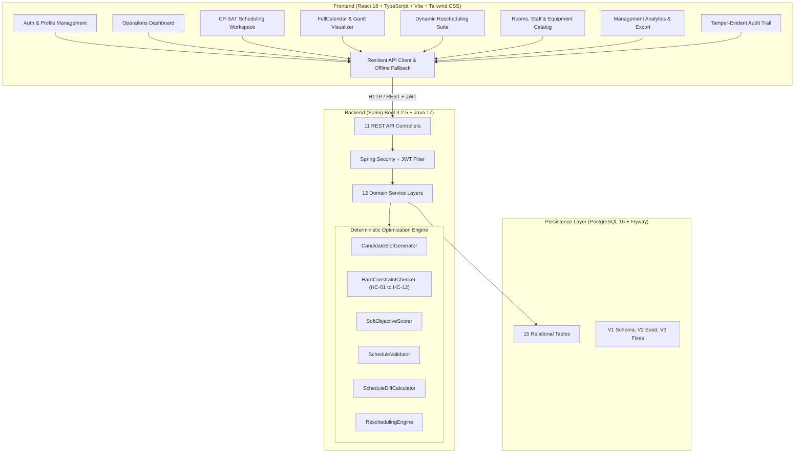
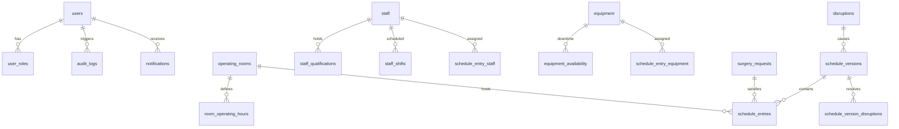

# Resource-Constrained Operating Room Scheduling & Dynamic Rescheduling System
## Complete Architecture, Functional Breakdown & Technical Reference Manual

---

## 1. System Overview & Architectural Vision

The **Resource-Constrained Operating Room Scheduling & Dynamic Rescheduling System** is an enterprise hospital operating-theater management platform. It solves the NP-hard problem of scheduling complex surgical cases across constrained operating suites, multi-disciplinary surgical teams, and specialized medical technologies, while handling unexpected real-time clinical disruptions (emergency polytrauma arrivals, equipment malfunctions, room closures, and surgery duration overruns).

### Deterministic Decision-Support Paradigm
> **Important:** This platform is **100% deterministic and constraint-based**. It does **NOT** rely on black-box artificial intelligence or machine learning heuristics. Every schedule, assignment, and reschedule alternative is computed using exact operations research logic, constraint satisfaction checking, and weighted multi-objective scoring. Every scheduling decision is fully verifiable, auditable, and reproducible.

### High-Level Architectural Diagram



---

## 2. Deterministic Scheduling & Constraint Mathematical Model

The scheduling engine treats the operating room timetable as a discrete multi-resource assignment optimization problem.

### 2.1 Hard Constraints (HC-01 through HC-12)
A schedule is considered **strictly infeasible** if any of the following 12 hard constraints are violated:

| Constraint ID | Constraint Name | Mathematical / Logical Rule | Validation Mechanism |
|---|---|---|---|
| **HC-01** | **No Room Overlap** | $\forall s_1, s_2 \in \text{Cases in Room } r : [s_1.\text{start}, s_1.\text{end}] \cap [s_2.\text{start}, s_2.\text{end}] = \emptyset$ | `HardConstraintChecker.checkRoomOverlaps()` |
| **HC-02** | **Room Operating Hours** | $s.\text{prepStart} \ge r.\text{openTime} \land s.\text{cleanupEnd} \le r.\text{closeTime}$ | `checkRoomOperatingHours()` |
| **HC-03** | **Room Type Capability** | $r.\text{roomType} \in s.\text{compatibleRoomTypes}$ (e.g. cardiac hybrid only for cardiac procedures) | `checkRoomCompatibility()` |
| **HC-04** | **No Staff Double-Booking** | $\forall p \in \text{Staff} : [s_1.\text{start}, s_1.\text{end}] \cap [s_2.\text{start}, s_2.\text{end}] = \emptyset$ | `checkStaffOverlaps()` |
| **HC-05** | **Staff Shift Bounds** | $s.\text{plannedStart} \ge p.\text{shiftStart} \land s.\text{plannedEnd} \le p.\text{shiftEnd}$ | `checkStaffShiftBounds()` |
| **HC-06** | **Mandatory Staff Roles** | Team must contain at least 1 certified Lead Surgeon, 1 Anesthetist, and 1 Scrub Nurse | `checkMandatoryStaffPresent()` |
| **HC-07** | **Staff Qualifications** | Surgeon & team members must possess active credentials for procedure category | `checkStaffQualifications()` |
| **HC-08** | **No Equipment Overlap** | $\forall e \in \text{Equipment} : [s_1.\text{start}, s_1.\text{end}] \cap [s_2.\text{start}, s_2.\text{end}] = \emptyset$ | `checkEquipmentOverlaps()` |
| **HC-09** | **Equipment Maintenance** | Case interval must not intersect scheduled equipment maintenance windows | `checkEquipmentAvailability()` |
| **HC-10** | **Turnaround Buffer** | Gap between consecutive cases in room $r \ge \max(s_1.\text{cleanup}, s_2.\text{prep})$ (minimum 15 min) | `checkTurnaroundBuffers()` |
| **HC-11** | **Patient Time Window** | $s.\text{plannedStart} \ge s.\text{earliestEligibleTime} \land s.\text{plannedEnd} \le s.\text{deadlineTime}$ | `checkPatientTimeWindows()` |
| **HC-12** | **Locked Case Immutability** | Cases marked `isLocked = true` must not be shifted or reallocated during rescheduling | `checkLockedCaseInvariance()` |

### 2.2 Soft Objective Function Scoring
When multiple feasible slots exist, candidate allocations are evaluated using a weighted multi-objective cost function:

$$\text{Minimize } Z = w_{\text{wait}} \cdot C_{\text{wait}} + w_{\text{idle}} \cdot C_{\text{idle}} + w_{\text{overtime}} \cdot C_{\text{overtime}} + w_{\text{deferral}} \cdot C_{\text{deferral}} - w_{\text{util}} \cdot U_{\text{OR}}$$

- **$C_{\text{wait}}$ (Waiting Time Penalty):** Triage-weighted delay beyond target date ($10\times$ for Emergency, $5\times$ for Urgent, $1\times$ for Elective).
- **$C_{\text{idle}}$ (Idle Gap Penalty):** Penalizes dead gaps between cases smaller than 45 minutes to prevent schedule fragmentation.
- **$C_{\text{overtime}}$ (Overtime Cost):** Exponential penalty for extending procedures past 19:00 shift closure.
- **$C_{\text{deferral}}$ (Unscheduled Case Cost):** Severe penalty for bumping requests to the next scheduling day.
- **$U_{\text{OR}}$ (Room Utilization Bonus):** Rewards maximizing active operating hours against total suite opening hours.

---

## 3. Module-by-Module Functional Breakdown

### 3.1 Authentication, Roles & Profile Governance
- **Primary Files:**
  - Frontend: `frontend/src/pages/SignUpPage.tsx`, `frontend/src/pages/LoginPage.tsx`, `frontend/src/pages/ProfilePage.tsx`, `frontend/src/contexts/AuthContext.tsx`
  - Backend: `backend/src/main/java/com/orscheduler/controller/AuthController.java`, `backend/src/main/java/com/orscheduler/service/UserService.java`, `backend/src/main/java/com/orscheduler/config/SecurityConfig.java`
- **What It Does:**
  - **Registration (`/signup`):** Allows clinical staff to create an account by providing Full Legal Name, Staff Username, Hospital Email, Primary Role, and Password (with live password match & length validation).
  - **Login (`/login`):** Authenticates credentials with BCrypt verification. Provides 1-click Quick Login shortcuts for rapid evaluation:
    - `System Admin` (`admin`) — Full governance and audit inspection.
    - `OR Manager` (`ormanager`) — Approves & publishes schedules; manages disruptions.
    - `Lead Scheduler` (`scheduler1`) — Runs deterministic optimization solver; configures penalty weights.
    - `Chief Surgeon` (`dr.alice`) — Case intake backlog & surgical timetable inspection.
  - **Profile (`/profile`):** Visual credential card displaying legal name, staff ID, clinical role badge, email, and departmental clearance. Allows updating names, emails, and passwords on demand.

### 3.2 Operating Rooms Management
- **Primary Files:**
  - Frontend: `frontend/src/pages/RoomsPage.tsx`
  - Backend: `backend/src/main/java/com/orscheduler/controller/OperatingRoomController.java`, `backend/src/main/java/com/orscheduler/service/OperatingRoomService.java`
- **What It Does:**
  - Catalogs operating suites: `OR-1 (General)`, `OR-2 (Orthopedic)`, `OR-3 (Cardiac Hybrid)`, `OR-4 (Neurosurgery)`, `OR-5 (Ambulatory Daycare)`.
  - Configures suite operating hours (07:00 to 19:00) and room capabilities.
  - Supports adding new surgical suites, updating equipment connections, and toggling operational status (`ACTIVE`, `MAINTENANCE`, `CLOSED`).

### 3.3 Surgical Staff & Shift Rostering
- **Primary Files:**
  - Frontend: `frontend/src/pages/StaffPage.tsx`
  - Backend: `backend/src/main/java/com/orscheduler/controller/StaffController.java`, `backend/src/main/java/com/orscheduler/service/StaffService.java`
- **What It Does:**
  - Tracks clinical staff by category: `SURGEON`, `ANESTHETIST`, `NURSE`, `TECHNICIAN`.
  - Maps credential qualifications (e.g. *General Surgery Board Certified*, *Cardiac Anesthesia Fellow*, *Certified Perioperative Nurse CNOR*).
  - Maintains weekly shift schedules and leave schedules to guarantee that cases are only allocated to surgeons and teams on active duty.

### 3.4 Surgical Equipment & Maintenance Downtime
- **Primary Files:**
  - Frontend: `frontend/src/pages/EquipmentPage.tsx`
  - Backend: `backend/src/main/java/com/orscheduler/controller/EquipmentController.java`, `backend/src/main/java/com/orscheduler/service/EquipmentService.java`
- **What It Does:**
  - Tracks specialized medical equipment: Laparoscopic HD Towers, C-Arm Fluoroscopes, Zeiss Surgical Microscopes, Dräger Anesthesia Machines, and ForceTriad Electrosurgical Units.
  - **Schedule Maintenance Modal:** Allows booking sterilization and calibration windows, automatically removing equipment from scheduling availability during maintenance.

### 3.5 Surgery Request Intake & Prioritization
- **Primary Files:**
  - Frontend: `frontend/src/pages/SurgeryRequestsPage.tsx`
  - Backend: `backend/src/main/java/com/orscheduler/controller/SurgeryRequestController.java`, `backend/src/main/java/com/orscheduler/service/SurgeryRequestService.java`, `backend/src/main/java/com/orscheduler/scheduling/RequestRanker.java`
- **What It Does:**
  - Manages surgical intake requests: Patient Pseudonym, Procedure Name, Priority (`EMERGENCY`, `URGENT`, `ELECTIVE`), ASA Physical Status, Estimated Duration, Pre-op Prep Buffer, Post-op Cleaning Buffer, and Earliest/Deadline times.
  - **RequestRanker:** Deterministically sorts requests by urgency:
    1. `EMERGENCY` cases (must be placed immediately).
    2. `URGENT` cases ranked by upcoming deadline.
    3. `ELECTIVE` cases ranked by waiting duration and ASA score.

### 3.6 Deterministic Scheduling Engine
- **Primary Files:**
  - Frontend: `frontend/src/pages/ScheduleGeneratePage.tsx`
  - Backend: `backend/src/main/java/com/orscheduler/scheduling/SchedulingEngine.java`, `backend/src/main/java/com/orscheduler/scheduling/CandidateSlotGenerator.java`, `backend/src/main/java/com/orscheduler/scheduling/HardConstraintChecker.java`, `backend/src/main/java/com/orscheduler/scheduling/SoftObjectiveScorer.java`
- **What It Does:**
  - Takes a target schedule date and selected case IDs.
  - Exposes interactive sliders for objective weights: Waiting Time Penalty ($w_{\text{wait}}$), Idle Gap Penalty ($w_{\text{idle}}$), Overtime Penalty ($w_{\text{overtime}}$), Deferral Penalty ($w_{\text{deferral}}$), and Utilization Weight ($w_{\text{util}}$).
  - Generates discrete non-overlapping candidate slots across compatible rooms.
  - Prunes all candidate slots violating constraints HC-01 through HC-12.
  - Scores remaining candidate slots and selects the global minimum-penalty assignment.
  - Creates a new `ScheduleVersion` in `PROPOSED` state.

### 3.7 Schedule Approval, Validation & Publishing
- **Primary Files:**
  - Frontend: `frontend/src/pages/ScheduleApprovalPage.tsx`
  - Backend: `backend/src/main/java/com/orscheduler/controller/ScheduleController.java`, `backend/src/main/java/com/orscheduler/service/ApprovalService.java`, `backend/src/main/java/com/orscheduler/scheduling/ScheduleValidator.java`
- **What It Does:**
  - **Validate Hard Constraints:** Executes a full constraint audit over all scheduled entries and displays pass/fail status for HC-01 through HC-12.
  - **Approve Schedule:** Transition version status to `APPROVED` with auditor signature and timestamp.
  - **Publish Live:** Transition approved version to `PUBLISHED`, superseding any previously active schedule.
  - **Rejection Workflow:** Allows entering feedback reasons and returning version to `REJECTED` for revision.

### 3.8 Schedule Calendar & Gantt Visualization
- **Primary Files:**
  - Frontend: `frontend/src/pages/ScheduleCalendarPage.tsx`, `frontend/src/pages/ScheduleGanttPage.tsx`, `frontend/src/components/schedule/TimelineGantt.tsx`
- **What It Does:**
  - **Calendar View:** Integrated multi-day/week/month calendar visualizing planned surgeries across the hospital.
  - **Surgical Gantt Lanes:** Room-by-room horizontal timeline lanes displaying three distinct visual phases for every procedure:
    1. *Pre-op Preparation Buffer* (patient sterile prep & equipment setup).
    2. *Incision-to-Closure Duration* (primary surgical procedure).
    3. *Turnaround Cleanup Buffer* (room sterilization and air exchange).

### 3.9 Dynamic Rescheduling & Operational Disruptions
- **Primary Files:**
  - Frontend: `frontend/src/pages/ReschedulingPage.tsx`, `frontend/src/components/schedule/ScheduleDiffModal.tsx`
  - Backend: `backend/src/main/java/com/orscheduler/controller/ReschedulingController.java`, `backend/src/main/java/com/orscheduler/scheduling/ReschedulingEngine.java`, `backend/src/main/java/com/orscheduler/scheduling/ScheduleDiffCalculator.java`
- **What It Does:**
  - **Disruption Registration:** Reports live clinical disruptions:
    - `EMERGENCY_ARRIVAL` (trauma case preemption).
    - `EQUIPMENT_FAILURE` (breakdown requiring room move or tool swap).
    - `ROOM_CLOSURE` (sterility contamination or facility maintenance).
    - `STAFF_ABSENCE` (sudden illness of designated surgeon or anesthetist).
    - `DURATION_OVERRUN` (case extending beyond scheduled completion).
  - **Deterministic Mitigation Alternatives:** Computes candidate repair schedules:
    - *Alternative A (Minimal Disruption):* Preserves existing assignments by shifting affected cases to adjacent open suites with minimal turnover buffer.
    - *Alternative B (Shift & Shift Bounds Preservation):* Delays elective procedures within the same suite while keeping surgeon assignments constant.
  - **Schedule Diff Modal:** Highlights exact changes between the active schedule and candidate alternatives (moved surgeries, original vs new rooms, time deltas $\Delta t$, and deferred cases).
  - **Adopt Alternative:** Commits the selected alternative as the new active schedule.

### 3.10 Operations Analytics & Executive Reporting
- **Primary Files:**
  - Frontend: `frontend/src/pages/AnalyticsPage.tsx`
  - Backend: `backend/src/main/java/com/orscheduler/controller/AnalyticsController.java`, `backend/src/main/java/com/orscheduler/service/AnalyticsService.java`
- **What It Does:**
  - Displays hospital theater KPIs: Overall OR Utilization Rate, Average Turnover Minutes, Emergency Wait Hours, and Overtime Hours.
  - Visual suite-by-suite utilization bars (`OR-1` through `OR-5`).
  - Delay reason breakdown distribution (transport delays, sterile setup delays, emergency preemption, calibration).
  - **Export CSV Report:** Generates and downloads full structured CSV performance datasets.

### 3.11 Tamper-Evident Audit Logging
- **Primary Files:**
  - Frontend: `frontend/src/pages/AuditLogPage.tsx`
  - Backend: `backend/src/main/java/com/orscheduler/controller/AuditLogController.java`, `backend/src/main/java/com/orscheduler/service/AuditService.java`
- **What It Does:**
  - Records immutable event logs for every major system mutation: `USER_REGISTERED`, `SCHEDULE_GENERATED`, `SCHEDULE_APPROVED`, `SCHEDULE_PUBLISHED`, `DISRUPTION_LOGGED`, `RESCHEDULE_COMMITTED`.
  - Captures action name, entity type, entity ID, username, details, and exact timestamp.
  - Provides instant keyword searching and user filtering.

---

## 4. REST API Specification

| Endpoint | HTTP Method | Allowed Roles | Description | Request Body / Parameters | Response Structure |
|---|---|---|---|---|---|
| `/api/auth/register` | `POST` | Public | Register new staff user account | `{ fullName, username, email, password, roles }` | `{ token, user }` |
| `/api/auth/login` | `POST` | Public | Authenticate user credentials | `{ username, password }` | `{ token, user }` |
| `/api/auth/me` | `GET` | Authenticated | Retrieve current session user | None | `User` object |
| `/api/auth/profile` | `PUT` | Authenticated | Update user profile & credentials | `{ fullName, email, password? }` | `User` object |
| `/api/rooms` | `GET` | Authenticated | List all operating rooms | Query: `status, search, page, size` | `{ content: OperatingRoom[], totalElements }` |
| `/api/rooms/active` | `GET` | Authenticated | Get all active rooms | None | `OperatingRoom[]` |
| `/api/rooms` | `POST` | `ADMIN`, `OR_MANAGER` | Create new operating room | `{ name, roomType, capacity, description }` | `OperatingRoom` |
| `/api/staff` | `GET` | Authenticated | List surgical roster | Query: `staffType, search, page, size` | `{ content: Staff[], totalElements }` |
| `/api/staff` | `POST` | `ADMIN`, `OR_MANAGER` | Enroll new staff member | `{ fullName, employeeId, staffType, email, phone }` | `Staff` |
| `/api/staff/{id}/shifts` | `GET` | Authenticated | Get shifts for staff member | Path: `id` | `StaffShift[]` |
| `/api/equipment` | `GET` | Authenticated | List technology catalog | Query: `status, type, page, size` | `{ content: Equipment[], totalElements }` |
| `/api/equipment` | `POST` | `ADMIN`, `OR_MANAGER` | Catalog new equipment unit | `{ name, equipmentType, serialNumber, model }` | `Equipment` |
| `/api/equipment/{id}/maintenance` | `POST` | `ADMIN`, `OR_MANAGER`, `SCHEDULER` | Schedule maintenance downtime | `{ unavailableFrom, unavailableTo, reason }` | Maintenance receipt |
| `/api/surgery-requests` | `GET` | Authenticated | List case intake requests | Query: `status, priority, search, page, size` | `{ content: SurgeryRequest[], totalElements }` |
| `/api/surgery-requests` | `POST` | Authenticated | Submit new surgery request | `{ procedureName, patientId, priority, estimatedDurationMinutes... }` | `SurgeryRequest` |
| `/api/schedules/generate` | `POST` | `SCHEDULER`, `OR_MANAGER`, `ADMIN` | Run deterministic solver | `{ scheduleDate, surgeryRequestIds, objectiveWeights }` | `ScheduleResponse` |
| `/api/schedules/active` | `GET` | Authenticated | Get active published schedule | Query: `date` | `ScheduleResponse` |
| `/api/schedules/{id}/validate` | `POST` | `SCHEDULER`, `OR_MANAGER`, `ADMIN` | Audit constraints HC-01 to HC-12 | Path: `id` | `ValidationResult` |
| `/api/schedules/{id}/approve` | `POST` | `OR_MANAGER`, `ADMIN` | Approve schedule version | Path: `id` | `ScheduleResponse` |
| `/api/schedules/{id}/publish` | `POST` | `OR_MANAGER`, `ADMIN` | Promote version to live | Path: `id` | `ScheduleResponse` |
| `/api/disruptions` | `GET` | Authenticated | List operational disruptions | Query: `page, size` | `{ content: Disruption[], totalElements }` |
| `/api/disruptions` | `POST` | Authenticated | Register new disruption | `{ disruptionType, description, occurredAt, affectedRoomId... }` | `Disruption` |
| `/api/reschedule` | `POST` | `OR_MANAGER`, `SCHEDULER`, `ADMIN` | Compute mitigation alternatives | `{ disruptionId, activeScheduleVersionId, maxAlternatives }` | `RescheduleAlternative[]` |
| `/api/reschedule/{id}/approve` | `POST` | `OR_MANAGER`, `ADMIN` | Adopt reschedule alternative | Path: `id`, Body: `{ alternativeId }` | `ScheduleResponse` |
| `/api/analytics` | `GET` | Authenticated | Compute KPI summary metrics | Query: `startDate, endDate` | `AnalyticsData` |
| `/api/analytics/export` | `GET` | Authenticated | Download CSV report | Query: `startDate, endDate` | CSV file stream |
| `/api/audit` | `GET` | `ADMIN`, `OR_MANAGER` | Get audit trail records | Query: `page, size` | `{ content: AuditLogItem[], totalElements }` |

---

## 5. Database Relational Schema

The PostgreSQL database schema consists of **15 interconnected tables** managed via Flyway migrations (`V1__initial_schema.sql`, `V2__seed_data.sql`, `V3__add_affected_surgery_to_disruptions.sql`):



1. **`users`:** Staff identity, username, password hash (BCrypt), full name, email, active flag.
2. **`user_roles`:** Role assignments (`ADMIN`, `OR_MANAGER`, `SCHEDULER`, `CLINICAL_STAFF`).
3. **`qualifications`:** Surgical credentials and medical certifications.
4. **`operating_rooms`:** Suites, room types, capacities, descriptions.
5. **`room_operating_hours`:** Day-of-week opening and closing time bounds.
6. **`staff`:** Surgical personnel, employee IDs, contact details, staff types.
7. **`staff_qualifications`:** Many-to-many credential mappings with certification & expiry dates.
8. **`staff_shifts`:** Recurring weekly shifts and approved leave intervals.
9. **`equipment`:** Medical machinery, serial numbers, models, operational statuses.
10. **`equipment_availability`:** Maintenance downtime windows.
11. **`surgery_requests`:** Surgical cases, priority, duration estimates, required capabilities, deadlines.
12. **`schedule_versions`:** Version control records, status (`DRAFT`, `PROPOSED`, `APPROVED`, `PUBLISHED`), optimization scores.
13. **`schedule_entries`:** Individual surgery placements with prep, planned, and cleanup timestamps.
14. **`disruptions`:** Recorded clinical interruptions, types, severities, affected resources.
15. **`audit_logs`:** Tamper-evident ledger of user actions and entity modifications.

---

## 6. Standalone & Offline Resilience Architecture

To ensure uninterrupted operation even when the Spring Boot backend or PostgreSQL container is offline during local evaluation or network partitioning:

- **Intelligent Offline Fallback (`frontend/src/api/axiosClient.ts`):**
  - If a REST request fails due to `ERR_CONNECTION_REFUSED`, `ERR_NETWORK`, or a proxy timeout, the client automatically switches to **Standalone Mode**.
  - All operations route through `frontend/src/api/mockData.ts`, which manages persistent state in browser `localStorage`.
- **Seamless Database Re-attachment:**
  - Whenever the backend container is launched, all API calls automatically pass through to the real Spring Boot server and PostgreSQL database without requiring code changes or application rebuilds.

---

## 7. How to Run the Platform

### Running with Docker Compose (Recommended Production Setup)
```bash
docker-compose up -d
```
- Spawns PostgreSQL 16 on port `5432` with Flyway auto-migration.
- Builds and runs Spring Boot 3.2.5 on port `8080`.
- Launches the React frontend on port `5173`.

### Running Locally for Development

**1. Frontend Dev Server:**
```powershell
cd d:\spm\frontend
npm run dev
```
Open **http://localhost:5173** in your browser.

**2. Backend Dev Server (when Java 17 & PostgreSQL are running):**
```powershell
cd d:\spm\backend
mvn spring-boot:run
```

**3. Frontend Production Build Verification:**
```powershell
cd d:\spm\frontend
npm run build
```
Compiles and bundles the application with zero type or packaging errors.
