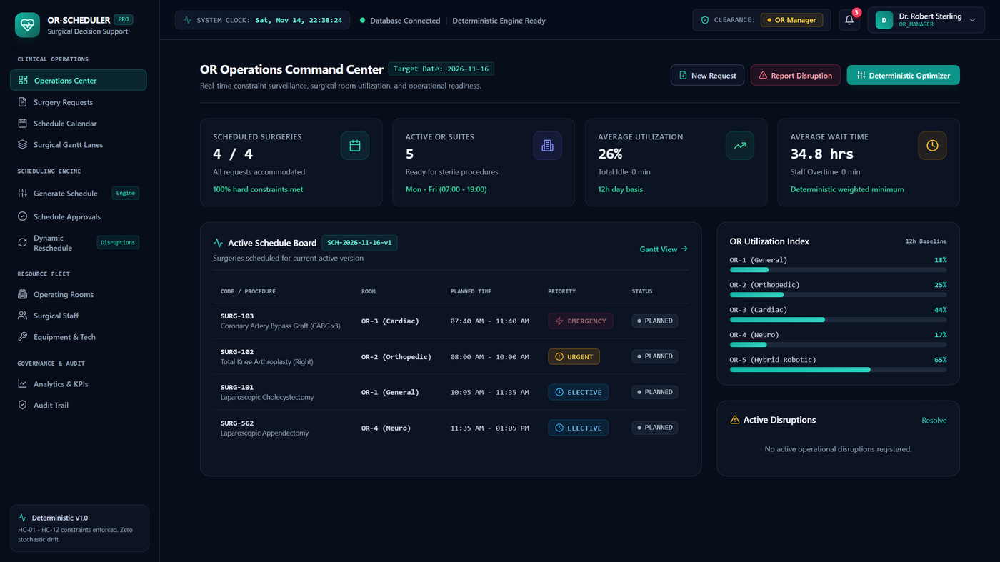
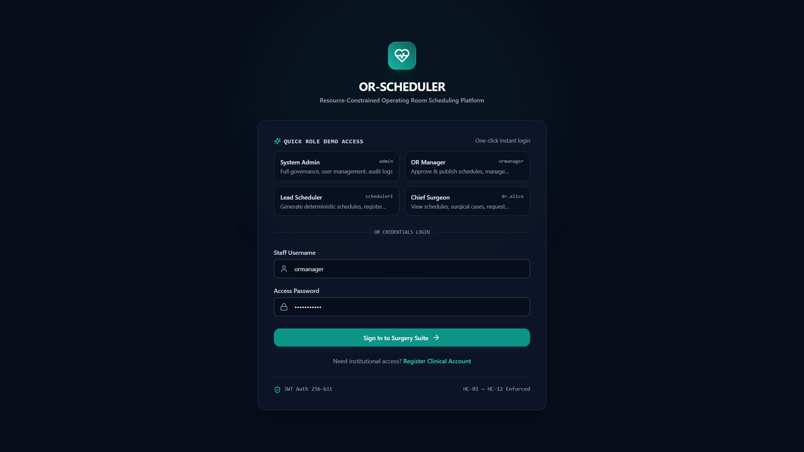
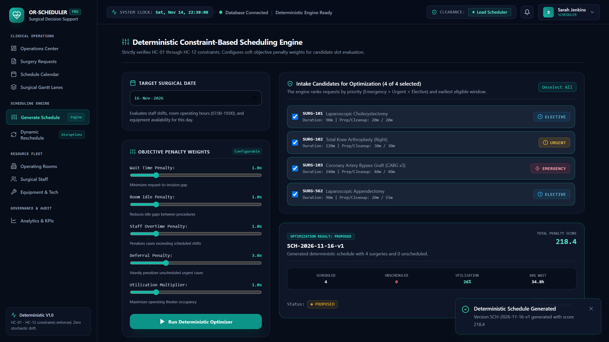
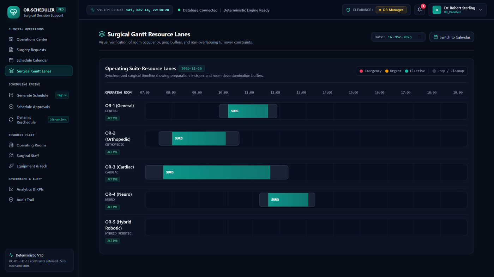
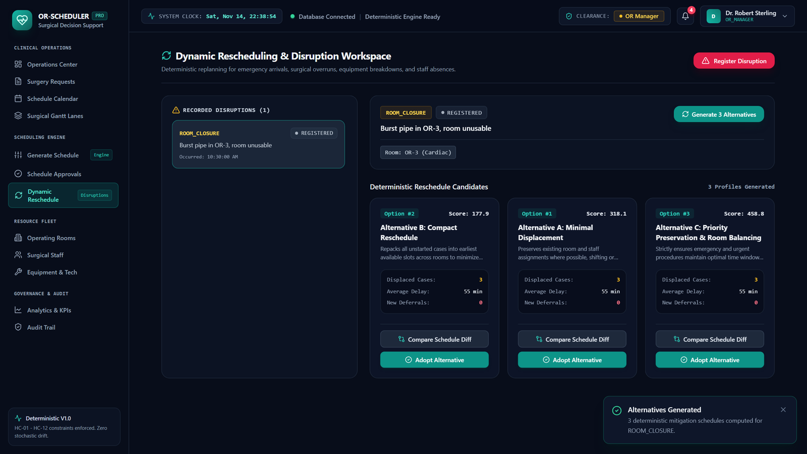
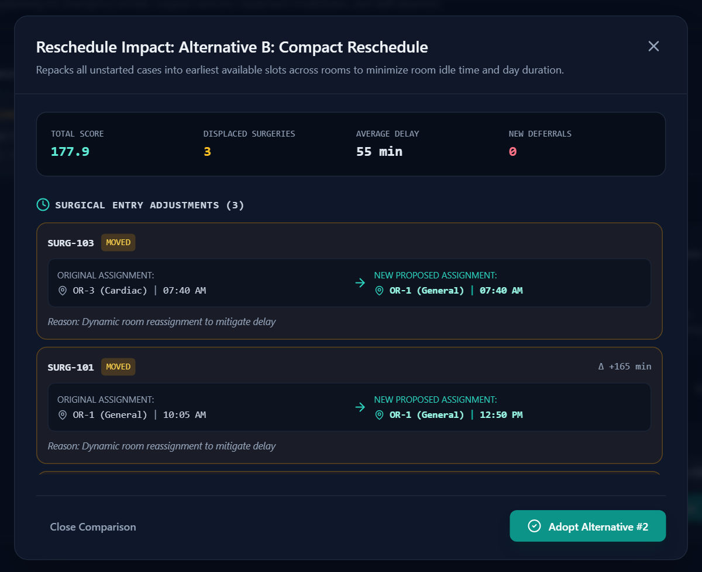
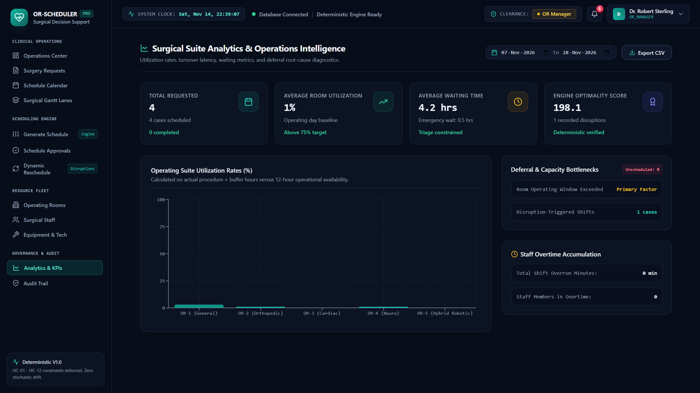
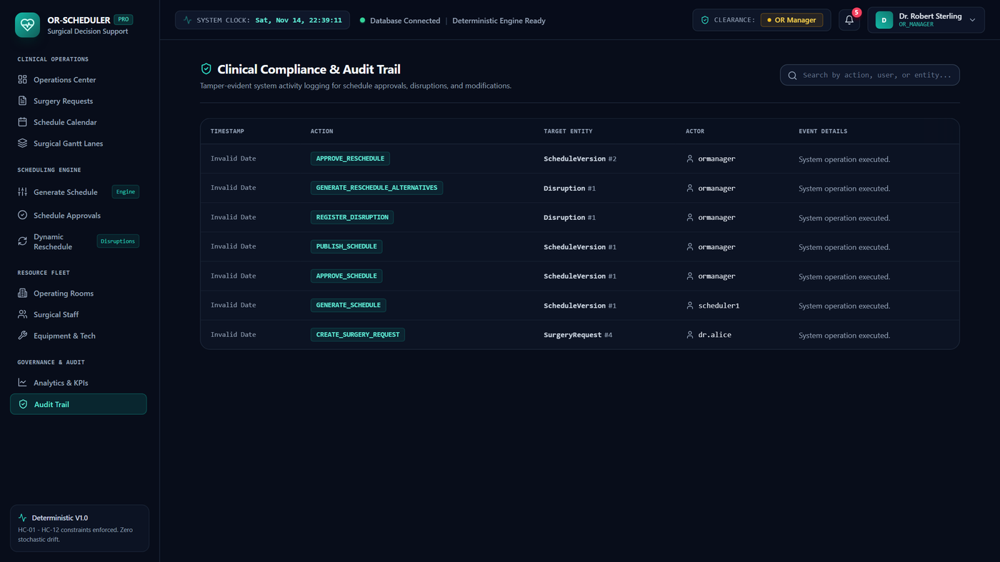
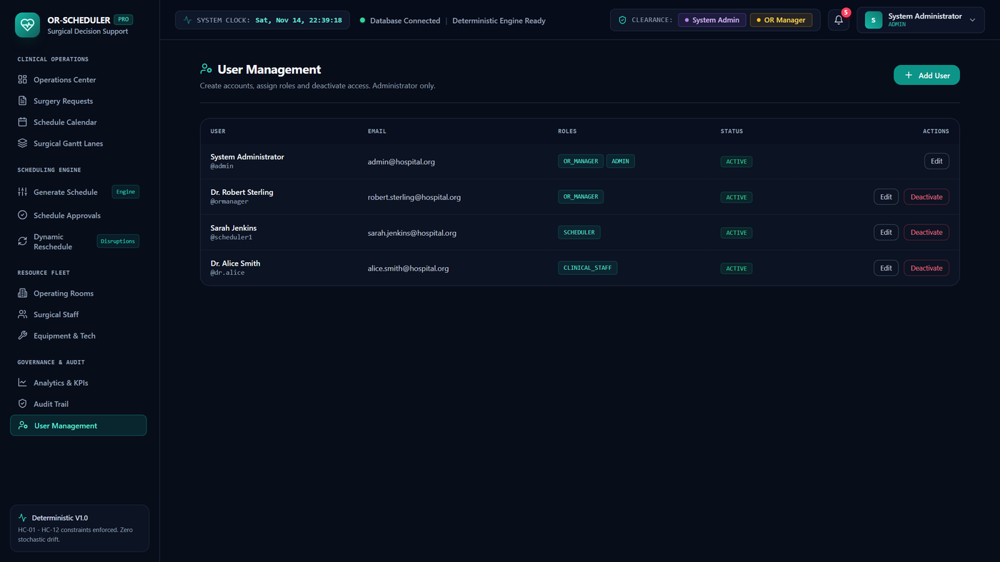
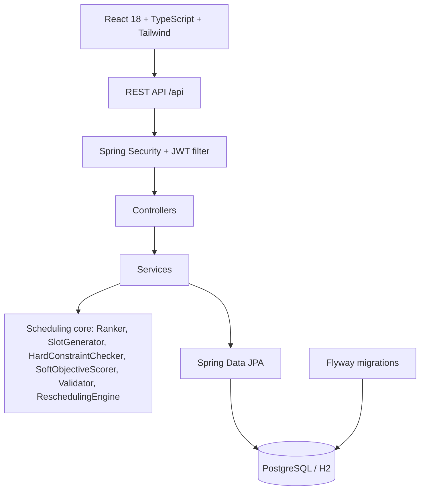

# OR-Scheduler

### Resource-Constrained Operating Room Scheduling & Dynamic Rescheduling

[](https://openjdk.org/)
[](https://spring.io/projects/spring-boot)
[](https://react.dev/)
[](https://www.typescriptlang.org/)
[](https://vitejs.dev/)
[](https://www.postgresql.org/)

A deterministic, constraint-based decision-support platform for hospital operating rooms. It builds conflict-free surgical schedules, validates them against 12 hard constraints, and re-plans within seconds when a disruption happens (emergency arrival, room closure, staff absence, equipment failure, cancellation, case overrun). Every action goes through a role-based approval workflow and is written to an audit trail.



## Table of contents
- [The problem](#the-problem)
- [Features](#features)
- [Screenshots](#screenshots)
- [User roles](#user-roles)
- [Quick start](#quick-start)
- [Configuration](#configuration)
- [How the scheduling engine works](#how-the-scheduling-engine-works)
- [Architecture](#architecture)
- [REST API](#rest-api)
- [Project structure](#project-structure)
- [Testing](#testing)
- [Presentation material](#presentation-material)
- [Known limitations and roadmap](#known-limitations-and-roadmap)

## The problem
Operating rooms are the most expensive and busiest hospital resource, yet many hospitals still plan them with spreadsheets and phone calls. That leads to double-booked rooms or surgeons, idle gaps, overtime, slow reaction to emergencies and no record of who changed what. OR-Scheduler automates the planning, guarantees the rules, and keeps an audit trail.

## Features
- **Smart schedule generation:** ranks cases by priority, waiting time and deadline, then searches 15-minute slots in every room and picks the best-scoring feasible one.
- **12 hard constraints (HC-01 to HC-12):** no room, staff or equipment overlap, qualifications, shifts and leave, room hours, maintenance windows and more. A schedule that violates one cannot be published.
- **Tunable objectives:** sliders for waiting time, room idle time, staff overtime, deferral and utilisation weights.
- **Approval workflow:** `PROPOSED` -> `APPROVED` -> `PUBLISHED`, with reject, and automatic `SUPERSEDED` for replaced versions.
- **Dynamic rescheduling:** six disruption types, three alternatives (minimal displacement, compact, priority preservation) with a before/after diff and delay minutes.
- **Resource management:** rooms (hours, status), staff (qualifications, weekly shifts, leave), equipment (status, maintenance windows).
- **Calendar and Gantt views:** FullCalendar plus custom room lanes showing prep, surgery and cleanup buffers.
- **Analytics and audit:** utilisation, waiting time, overtime, deferrals, CSV export, notifications and an audit log.
- **Security:** JWT authentication, BCrypt passwords, role rules enforced per endpoint, self-registration limited to a clinical account.

## Screenshots

| | |
|---|---|
|  **Login with quick demo roles** |  **Deterministic optimiser** |
|  **Gantt room lanes** |  **Three re-planning alternatives** |
|  **Schedule diff before adopting** |  **Analytics** |
|  **Audit trail** |  **User management (admin)** |

## User roles

All demo accounts use the password `password123`. **Change or remove them before any real deployment.**

| Role | Username | Can do |
|---|---|---|
| Clinical Staff | `dr.alice` | View dashboard, calendar, Gantt and resources, file surgery requests, notifications |
| Scheduler | `scheduler1` | Everything above, plus cancel requests, generate schedules, register disruptions, generate alternatives, analytics |
| OR Manager | `ormanager` | Everything above, plus approve / reject / publish schedules, adopt reschedules, manage rooms, staff, shifts and equipment, audit log, CSV export |
| Admin | `admin` | Everything above (this account also holds OR Manager), plus user management (create users, assign roles, deactivate) |

The rule: the **scheduler proposes, the manager decides, the admin governs**. Permissions are enforced in the backend, not only hidden in the UI.

## Quick start

### Prerequisites
- JDK 17
- Maven 3.9+
- Node.js 18+ (tested with 24)

No database installation is needed for local development: the default `local` profile uses an in-memory H2 database that is seeded on start-up.

### 1. Start the backend
```bash
cd backend
mvn spring-boot:run
```
- API: http://localhost:8080
- Swagger UI: http://localhost:8080/swagger-ui.html

### 2. Start the frontend
```bash
cd frontend
npm install
npm run dev
```
Open http://localhost:5173 and sign in with one of the demo accounts above (the login page has one-click role buttons). The dev server proxies `/api` to `localhost:8080`.

> The seeded surgery requests are dated for the next working day (Monday if you start on a weekend), and operating rooms run Monday to Friday. In the Generate page, keep the default date.

### Suggested walkthrough
1. Log in as `dr.alice` and file a surgery request.
2. Log in as `scheduler1`, open **Generate Schedule** and run the optimiser (result is `PROPOSED`).
3. Log in as `ormanager`, open **Schedule Approvals**, validate, approve and publish.
4. Open **Gantt Lanes**, then **Dynamic Reschedule**: register a `ROOM_CLOSURE`, generate three alternatives, compare the diff and adopt one.
5. Check **Analytics** and **Audit Trail**.
6. Log in as `admin` and open **User Management**.

### Run with Docker (PostgreSQL)
```bash
docker compose up -d --build   # PostgreSQL + backend on :8080 (profile: prod)
cd frontend && npm install && npm run dev
```
> The PostgreSQL / Docker path has not been verified end to end in this release; the default H2 path is the tested one.

## Configuration

Backend settings are environment variables with local defaults (see [`.env.template`](.env.template)):

| Variable | Default | Purpose |
|---|---|---|
| `SPRING_PROFILES_ACTIVE` | `local` | `local` = in-memory H2, any other value uses PostgreSQL |
| `DB_HOST` / `DB_PORT` / `DB_NAME` | `localhost` / `5432` / `orscheduler` | PostgreSQL connection |
| `DB_USERNAME` / `DB_PASSWORD` | `orscheduler` / `orscheduler_pass` | PostgreSQL credentials |
| `JWT_SECRET` | development key | **Set a long random secret in production** |
| `JWT_EXPIRATION` | `86400000` | Token lifetime in ms (24 h) |
| `CORS_ORIGINS` | `http://localhost:5173,http://localhost:3000` | Allowed browser origins |
| `SERVER_PORT` | `8080` | HTTP port |

Frontend: set `VITE_STANDALONE=true` only if you want the legacy offline demo data (it is off by default so real backend errors are visible).

## How the scheduling engine works

```
Rank requests -> generate 15-min candidate slots per room -> assemble team + equipment
   -> filter by hard constraints (HC-01..12) -> score with weighted penalty
   -> pick best slot -> independent validator -> save PROPOSED version
```

**Ranking:** emergency (100000) > urgent (50000) > elective (10000), plus 10 points per hour waited and a deadline-proximity bonus.

**Hard constraints**

| ID | Rule |
|---|---|
| HC-01 | No overlapping room use (including prep and cleanup buffers) |
| HC-02 | No overlapping staff assignments |
| HC-03 | No overlapping equipment bookings |
| HC-04 | Role and qualification match for the surgical team |
| HC-05 | Case fits its earliest-start / deadline window |
| HC-06 | Buffer order: prep <= start < end <= cleanup |
| HC-07 | Staff on shift and not on leave |
| HC-08 | Inside room operating hours (closed on days without hours) |
| HC-09 | Required qualifications held by the team (not expired) |
| HC-10 | In-progress, completed or locked cases are never moved |
| HC-11 | Equipment not in maintenance or decommissioned |
| HC-12 | Room must be `ACTIVE` |

**Soft objective (minimised):**
`w1*WaitingHours + w2*RoomIdleHours + w3*StaffOvertimeHours + w4*DeferralPenalty - w5*Utilisation`

The same input and weights always produce the same schedule. The search is a greedy heuristic: fast and explainable, not provably optimal.

## Architecture



## REST API

Full interactive docs: `http://localhost:8080/swagger-ui.html`.

| Area | Endpoints | Access |
|---|---|---|
| Auth | `POST /api/auth/login`, `POST /api/auth/register`, `GET /api/auth/me`, `PUT /api/auth/profile` | Public (login, register), authenticated |
| Rooms | `GET /api/rooms`, `/active`, `/{id}` | Authenticated |
| | `POST`, `PUT /api/rooms` | Admin, OR Manager |
| | `DELETE /api/rooms/{id}` (close) | Admin |
| Staff | `GET /api/staff`, `/active`, `/{id}`, `/{id}/shifts`, `/qualifications` | Authenticated |
| | `POST`, `PUT`, `DELETE /api/staff`, shifts and leave, `POST /{id}/reactivate` | Admin, OR Manager |
| Equipment | `GET /api/equipment`, `/available`, `/{id}` | Authenticated |
| | `POST`, `PUT /api/equipment`, `POST /{id}/maintenance` | Admin, OR Manager |
| Surgery requests | `GET`, `POST /api/surgery-requests`, `PATCH /{id}/status` | Authenticated |
| | `DELETE /api/surgery-requests/{id}` (cancel) | Admin, OR Manager, Scheduler |
| Schedules | `GET /api/schedules`, `/active`, `/{id}`, `POST /{id}/validate` | Authenticated |
| | `POST /api/schedules/generate` | Admin, OR Manager, Scheduler |
| | `POST /api/schedules/{id}/approve`, `/reject`, `/publish` | Admin, OR Manager |
| Disruptions | `POST`, `GET /api/disruptions` | Authenticated |
| Rescheduling | `POST /api/reschedule`, `GET /api/reschedule/{id}/alternatives` | Admin, OR Manager, Scheduler |
| | `POST /api/reschedule/{id}/approve` | Admin, OR Manager |
| Analytics | `GET /api/analytics` | Admin, OR Manager, Scheduler |
| | `GET /api/analytics/export` (CSV) | Admin, OR Manager |
| Audit | `GET /api/audit`, `/entity` | Admin, OR Manager |
| Notifications | `GET /api/notifications`, `/unread-count`, `PATCH /{id}/read`, `/read-all` | Authenticated |
| Users | `GET`, `POST`, `PUT`, `DELETE /api/users` | Admin |

## Project structure

```
.
├── backend/                     Spring Boot application
│   └── src/main/java/com/orscheduler/
│       ├── config/              Security, CORS, Swagger, seed data
│       ├── controller/          REST controllers
│       ├── dto/                 Request / response objects
│       ├── entity/ repository/  JPA model and repositories
│       ├── scheduling/          Ranker, slot generator, constraint checker,
│       │                        scorer, validator, rescheduling engine, diff
│       ├── security/            JWT filter and token provider
│       ├── service/             Business logic
│       └── exception/           Global error handling
│   └── src/main/resources/db/migration/   Flyway V1..V3
├── frontend/                    React + TypeScript (Vite)
│   └── src/{pages,components,contexts,api,types,utils}
├── docs/screenshots/            README images
├── presentation/                Demo deck and speaker script
├── docker-compose.yml           PostgreSQL + backend
└── .env.template
```

## Testing

```bash
cd backend && mvn test            # 14 unit tests: constraint checker, validator, scheduling and rescheduling engines
cd frontend && npm run build      # TypeScript type-check + production build
```

In addition, the whole API was exercised with a scripted end-to-end run (all four roles, allowed and forbidden calls, the full generate -> approve -> publish -> disrupt -> reschedule workflow). That script is not part of this repository.

## Presentation material
- [`presentation/OR-Scheduler-Demo.pptx`](presentation/OR-Scheduler-Demo.pptx) (PDF copy included): 41-slide demo deck with screenshots, code snippets and project Q&A.
- [`presentation/Presentation-Script.md`](presentation/Presentation-Script.md): slide-by-slide speaking script and demo steps.
- [`COMPLETE_SYSTEM_DOCUMENTATION.md`](COMPLETE_SYSTEM_DOCUMENTATION.md) and [`system_functional_and_page_reference.md`](system_functional_and_page_reference.md): original design notes.

## Known limitations and roadmap
- Greedy heuristic, not a proven optimum (future: CP-SAT / ILP solver).
- Schedules a single day at a time.
- The default demo database is in-memory and resets on restart; the PostgreSQL path is not verified end to end.
- Reschedule alternatives are cached in memory (lost on restart, not cluster-safe).
- Notifications are polled every 30 s (future: WebSockets, e-mail / SMS).
- JWT is stored in browser storage; no refresh tokens or password reset yet.
- No EHR / HL7 integration; no automated UI tests or CI pipeline yet.

## Author
[kshitiz113](https://github.com/kshitiz113)
