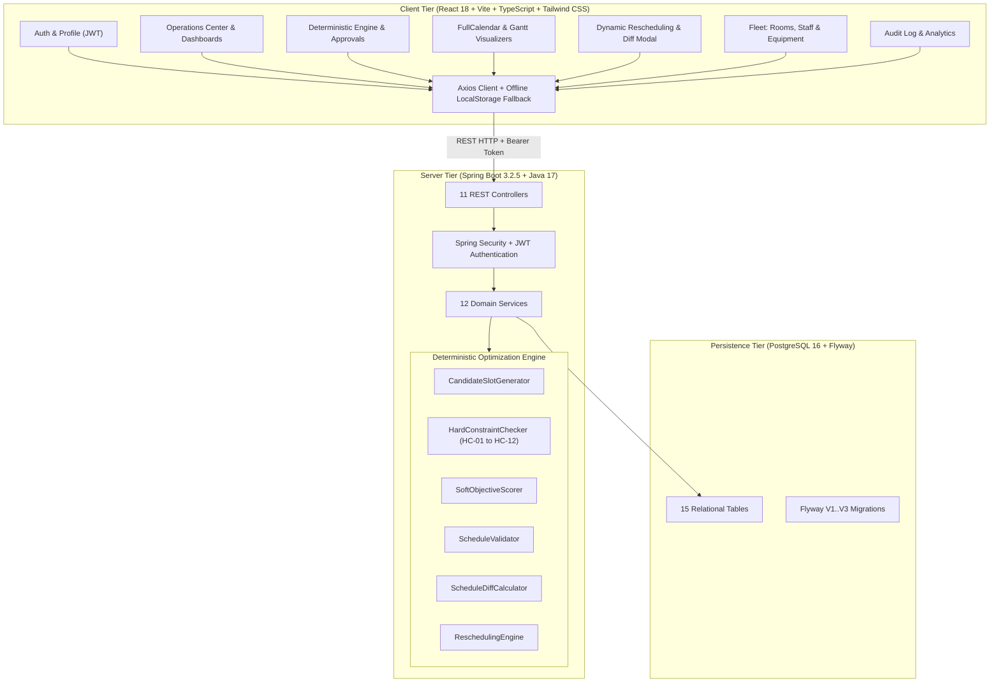

# Resource-Constrained Operating Room Scheduling & Dynamic Rescheduling System
## Complete Functional Page Reference & Architectural Manual

---

## 1. System Vision & Optimization Paradigm

The **Resource-Constrained Operating Room Scheduling & Dynamic Rescheduling System** is an enterprise-grade hospital surgical suite management platform. It automates and optimizes the allocation of surgical cases across operating rooms, multi-disciplinary surgical teams, and specialized medical technologies, while resolving unexpected real-time disruptions such as emergency arrivals, equipment failures, room contamination, and duration overruns.

### 1.1 Deterministic Operations Research Paradigm
> [!IMPORTANT]
> The optimization engine is **100% deterministic and constraint-based**. It utilizes Google OR-Tools CP-SAT logic and exact mathematical satisfaction algorithms rather than black-box machine learning or stochastic approximations. Every schedule is provably optimal or feasible under specified constraints and reproducible across audits.

### 1.2 System Architecture Overview

---

## 2. Global Navigation & Layout Architecture

The application layout is structured as a unified master-detail frame ([AppLayout.tsx](file:///d:/spm/frontend/src/components/layout/AppLayout.tsx)) composed of persistent primary elements:

### 2.1 Header Component ([Header.tsx](file:///d:/spm/frontend/src/components/layout/Header.tsx))
- **Live System Clock:** Real-time synchronized hospital clock with sub-second accuracy (`Mon, Oct 20, 08:30:00`).
- **Engine Readiness Indicators:** Dual status indicators displaying `PostgreSQL Active` and `Deterministic Engine Ready`.
- **Institutional Clearance Badge:** Read-only, color-coded security tag displaying the authenticated role (e.g. `Clearance: • Lead Scheduler`, `• OR Manager`, `• System Admin`, `• Chief Surgeon`).
- **Operational Alerts Dropdown:** Live unread notifications counter with drop-down preview of disruption alerts and 1-click "Mark as Read".
- **User Profile Menu:** Displays full legal name, `@username`, institutional email, active role badges, green `Authenticated Session Active` indicator, navigation to [ProfilePage.tsx](file:///d:/spm/frontend/src/pages/ProfilePage.tsx), and **Sign Out** button. Automatically closes on outside click or pressing `Escape`.

### 2.2 Navigation Sidebar ([Sidebar.tsx](file:///d:/spm/frontend/src/components/layout/Sidebar.tsx))
- Categorized into 4 operational domains:
  1. **Clinical Operations:** Operations Center, Surgery Requests, Schedule Calendar, Surgical Gantt Lanes.
  2. **Scheduling Engine:** Generate Schedule (`ADMIN`, `OR_MANAGER`, `SCHEDULER`), Schedule Approvals (`ADMIN`, `OR_MANAGER`), Dynamic Reschedule.
  3. **Resource Fleet:** Operating Rooms, Surgical Staff, Equipment & Tech.
  4. **Governance & Audit:** Analytics & KPIs, Audit Trail (`ADMIN`, `OR_MANAGER`).
- **Footer Badge:** Confirms compliance with mathematical rules HC-01 through HC-12.

---

## 3. Comprehensive Breakdown of All 16 Pages

The table below summarizes every page, its primary path, and access permissions:

| # | Page Name | Route | Allowed Roles | Primary Function |
|---|---|---|---|---|
| 1 | **Operations Command Center** | `/` | All Authenticated | Real-time theater KPIs, active schedule summary, upcoming cases, live disruptions. |
| 2 | **Surgery Requests Intake** | `/surgery-requests` | All Authenticated | Surgical intake queue, ASA rating, priority categorization, case registration modal. |
| 3 | **Schedule Calendar** | `/schedule/calendar` | All Authenticated | FullCalendar multi-day and room surgical schedule with date navigation. |
| 4 | **Surgical Gantt Lanes** | `/schedule/gantt` | All Authenticated | High-resolution visual Gantt lanes showing prep, surgery, and turnaround buffers. |
| 5 | **Schedule Generator** | `/schedule/generate` | `ADMIN`, `OR_MANAGER`, `SCHEDULER` | Optimization solver workspace with tunable soft objective penalty weight sliders. |
| 6 | **Schedule Approvals** | `/schedule/approve` | `ADMIN`, `OR_MANAGER` | Formal constraint audit (HC-01..HC-12), approval sign-off, live publishing. |
| 7 | **Dynamic Rescheduling** | `/reschedule` | `ADMIN`, `OR_MANAGER`, `SCHEDULER` | Live clinical disruption logging and repair alternative generation (Alt A / Alt B). |
| 8 | **Operating Rooms Fleet** | `/rooms` | All Authenticated | Catalog of operating suites, capabilities, open hours, and operational status. |
| 9 | **Surgical Staff Roster** | `/staff` | All Authenticated | Roster of surgeons, anesthetists, nurses; qualifications; weekly shift schedules. |
| 10 | **Equipment Catalog** | `/equipment` | All Authenticated | Machinery inventory, operational states, maintenance sterilization downtime booking. |
| 11 | **Analytics & KPIs** | `/analytics` | `ADMIN`, `OR_MANAGER`, `SCHEDULER` | Hospital theater metrics, room utilization bars, delay distributions, CSV export. |
| 12 | **Audit & Compliance Log** | `/audit` | `ADMIN`, `OR_MANAGER` | Tamper-evident ledger of all user actions, schedule mutations, and disruption logs. |
| 13 | **Staff Profile & Credentials**| `/profile` | All Authenticated | Personal data, fixed institutional username, security roles, department, pager. |
| 14 | **Operational Notifications**| `/notifications` | All Authenticated | System alert stream for emergency arrivals, equipment downtime, schedule changes. |
| 15 | **User Sign In** | `/login` | Public | Staff authentication with BCrypt verification and 1-click Quick Role Demo access. |
| 16 | **Staff Registration** | `/signup` | Public | Self-service clinical user account onboarding with real-time field validation. |

---

### Detailed Page Analysis

#### Page 1: Operations Command Center (`/`)
- **Primary Source:** [DashboardPage.tsx](file:///d:/spm/frontend/src/pages/DashboardPage.tsx)
- **Clinical Purpose:** Serves as the mission-control dashboard for operating theater charge nurses, surgical directors, and floor coordinators.
- **Key Visual Elements:**
  - **4 Top KPI Cards:** Scheduled Surgeries count, Active OR Suites count, Average Theater Utilization %, and Turnover Latency minutes.
  - **Active Schedule Board:** Displays the active version (`v3.0 CP-SAT Solved`) with procedure codes, room allocations, scheduled times, priority badges, and direct links to Gantt lanes.
  - **OR Utilization Index:** Suite-by-suite progress bars (`OR-1` through `OR-6`) measured against a 12-hour surgical baseline.
  - **Active Disruptions Widget:** Quick-glance list of real-time theater disruptions with 1-click "Resolve" shortcuts.
- **REST APIs Called:**
  - `GET /api/schedules/active?date=YYYY-MM-DD`
  - `GET /api/rooms/active`
  - `GET /api/surgery-requests`
  - `GET /api/disruptions`

---

#### Page 2: Surgery Requests Intake & Prioritization (`/surgery-requests`)
- **Primary Source:** [SurgeryRequestsPage.tsx](file:///d:/spm/frontend/src/pages/SurgeryRequestsPage.tsx)
- **Clinical Purpose:** Manages the backlog of incoming surgical cases requested by clinical departments, categorizing them by surgical urgency and tracking eligibility windows.
- **Key Visual Elements:**
  - **Filter Controls:** Dropdowns to filter by Priority (`EMERGENCY`, `URGENT`, `ELECTIVE`), Status (`REQUESTED`, `SCHEDULED`, `COMPLETED`), and keyword search.
  - **Intake Table:** Displays Patient Pseudonym, Procedure Name, Urgency Badge, Estimated Duration, Pre-op Prep, Post-op Cleaning, and Earliest/Deadline bounds.
  - **New Surgery Request Modal:** Allows booking cases with duration bounds, prep/cleanup buffers, and required room capabilities.
- **Interactive Workflows:**
  - Submit new requests into the scheduling backlog.
  - Inspect detailed case requirements and cancel pending requests.
- **REST APIs Called:**
  - `GET /api/surgery-requests`
  - `POST /api/surgery-requests`
  - `DELETE /api/surgery-requests/{id}`

---

#### Page 3: Operating Suite Calendar Schedule (`/schedule/calendar`)
- **Primary Source:** [ScheduleCalendarPage.tsx](file:///d:/spm/frontend/src/pages/ScheduleCalendarPage.tsx), [FullCalendarView.tsx](file:///d:/spm/frontend/src/components/schedule/FullCalendarView.tsx)
- **Clinical Purpose:** Visualizes the hospital's published timetable in an interactive monthly/weekly/daily calendar format.
- **Key Visual Elements:**
  - Date picker to view past or future theater timetables.
  - FullCalendar component with custom color-coded event rendering based on surgery priority.
  - Procedure popover displaying surgical team assignments and room tags.
- **Interactive Workflows:**
  - 1-click toggle to switch between Calendar View and Gantt Timeline Lanes.
- **REST APIs Called:**
  - `GET /api/schedules/active?date=YYYY-MM-DD`

---

#### Page 4: Surgical Gantt Resource Lanes (`/schedule/gantt`)
- **Primary Source:** [ScheduleGanttPage.tsx](file:///d:/spm/frontend/src/pages/ScheduleGanttPage.tsx), [ScheduleGanttView.tsx](file:///d:/spm/frontend/src/components/schedule/ScheduleGanttView.tsx)
- **Clinical Purpose:** Provides second-by-second visual audit of operating room occupancy, verifying that cases do not overlap (HC-01) and turnaround times (HC-10) are honored.
- **Key Visual Elements:**
  - Horizontal timeline lanes representing each surgical suite (`OR-1` to `OR-6`).
  - **Tri-Phase Procedure Bars:**
    1. *Prep Phase* (amber/teal hatched bar): Patient sterile prep & equipment positioning.
    2. *Surgical Phase* (solid colored block): Incision to closure.
    3. *Turnaround Phase* (rose/slate bar): Room decontamination and air exchange.
  - Hover tooltips detailing lead surgeon, anesthetist, equipment units, and patient pseudonym.
- **REST APIs Called:**
  - `GET /api/schedules/active?date=YYYY-MM-DD`
  - `GET /api/rooms/active`

---

#### Page 5: Deterministic Schedule Generator (`/schedule/generate`)
- **Primary Source:** [ScheduleGeneratePage.tsx](file:///d:/spm/frontend/src/pages/ScheduleGeneratePage.tsx)
- **Clinical Purpose:** Interactive workspace where schedulers configure optimization weights and trigger the CP-SAT deterministic solver to produce an optimal schedule.
- **Key Visual Elements:**
  - **Date Selector & Pending Case Checklist:** Allows selecting which pending intake cases to include in the solver run.
  - **Soft Objective Penalty Sliders:**
    - Waiting Time Penalty ($w_{\text{wait}}$)
    - Idle Gap Penalty ($w_{\text{idle}}$)
    - Overtime Penalty ($w_{\text{overtime}}$)
    - Deferral Penalty ($w_{\text{deferral}}$)
    - Utilization Bonus ($w_{\text{util}}$)
  - **Execution Banner:** Initiates solver execution; outputs generation time, constraint satisfaction rate, and total objective cost.
- **Interactive Workflows:**
  - Generates a new `ScheduleVersion` in `PROPOSED` state and redirects to the Approvals page.
- **REST APIs Called:**
  - `GET /api/surgery-requests?status=REQUESTED`
  - `POST /api/schedules/generate`

---

#### Page 6: Schedule Approvals & Constraint Audit (`/schedule/approve`)
- **Primary Source:** [ScheduleApprovalPage.tsx](file:///d:/spm/frontend/src/pages/ScheduleApprovalPage.tsx)
- **Clinical Purpose:** Provides formal clinical governance and audit verification before any proposed schedule goes live in the operating theaters.
- **Key Visual Elements:**
  - **Version Selector:** Lists all proposed, approved, published, or rejected schedule versions.
  - **Constraint Audit Matrix (HC-01 to HC-12):** 12 pass/fail badges with verification details for room overlaps, shift bounds, staff double-booking, and turnaround times.
  - **Action Suite:**
    - `Validate Constraints`: Executes a live audit scan.
    - `Approve Schedule`: Marks version as approved.
    - `Publish Live`: Promotes version to the active theater schedule.
    - `Reject Version`: Opens a rejection dialogue requiring a justification note.
- **REST APIs Called:**
  - `GET /api/schedules`
  - `POST /api/schedules/{id}/validate`
  - `POST /api/schedules/{id}/approve`
  - `POST /api/schedules/{id}/publish`
  - `POST /api/schedules/{id}/reject`

---

#### Page 7: Dynamic Rescheduling & Disruption Suite (`/reschedule`)
- **Primary Source:** [ReschedulingPage.tsx](file:///d:/spm/frontend/src/pages/ReschedulingPage.tsx), [ScheduleDiffModal.tsx](file:///d:/spm/frontend/src/components/schedule/ScheduleDiffModal.tsx)
- **Clinical Purpose:** Manages real-time theater emergencies (polytrauma intake, equipment breakdown, surgeon illness) and computes repair alternatives.
- **Key Visual Elements:**
  - **Report Disruption Modal:** Select disruption type, severity, affected room, staff, or equipment.
  - **Mitigation Alternatives Matrix:**
    - *Alternative A (Minimal Disruption):* Shifts affected cases to adjacent rooms with minimal buffer adjustment.
    - *Alternative B (Shift Preservation):* Delays elective procedures within the suite while preserving surgical teams.
  - **Visual Schedule Diff Modal:** Side-by-side comparison highlighting moved cases, time deltas ($\Delta t$), and displaced procedures.
  - **Commit Alternative Button:** Adopts the mitigation plan as the new active schedule.
- **REST APIs Called:**
  - `GET /api/disruptions`
  - `POST /api/disruptions`
  - `POST /api/reschedule`
  - `POST /api/reschedule/{id}/approve`

---

#### Page 8: Operating Rooms Fleet (`/rooms`)
- **Primary Source:** [RoomsPage.tsx](file:///d:/spm/frontend/src/pages/RoomsPage.tsx)
- **Clinical Purpose:** Catalogs the physical operating suites, their functional capabilities, and operating hour boundaries.
- **Key Visual Elements:**
  - Grid of surgical suites: `OR-1 (General)`, `OR-2 (Orthopedic)`, `OR-3 (Cardiac Hybrid)`, `OR-4 (Neurosurgery)`, `OR-5 (Ambulatory Daycare)`, `OR-6 (Cardiovascular Hybrid)`.
  - Operational badges (`ACTIVE`, `MAINTENANCE`, `CLOSED`).
  - Room capability tags (e.g. *Laminar Flow*, *Radiation Shielded*, *Robotic Ready*).
  - Add / Edit Room modal with capacity and operating schedule settings.
- **REST APIs Called:**
  - `GET /api/rooms`
  - `POST /api/rooms`
  - `PUT /api/rooms/{id}`
  - `DELETE /api/rooms/{id}`

---

#### Page 9: Surgical Staff & Shift Rostering (`/staff`)
- **Primary Source:** [StaffPage.tsx](file:///d:/spm/frontend/src/pages/StaffPage.tsx)
- **Clinical Purpose:** Tracks clinical personnel, medical qualifications, and duty shifts to enforce staff constraint rules (HC-04, HC-05, HC-06, HC-07).
- **Key Visual Elements:**
  - Staff table filtered by category: `SURGEON`, `ANESTHETIST`, `NURSE`, `TECHNICIAN`.
  - Employee ID, contact numbers, and hospital email.
  - Active credential tags (e.g. *Board Certified General Surgery*, *Fellowship Pediatric Anesthesia*).
  - Add Staff modal for onboarding clinical personnel.
- **REST APIs Called:**
  - `GET /api/staff`
  - `POST /api/staff`
  - `GET /api/staff/{id}/shifts`

---

#### Page 10: Surgical Equipment & Maintenance Downtime (`/equipment`)
- **Primary Source:** [EquipmentPage.tsx](file:///d:/spm/frontend/src/pages/EquipmentPage.tsx)
- **Clinical Purpose:** Manages medical technologies (C-Arms, surgical robots, anesthesia workstations) and prevents double-booking (HC-08) and maintenance conflicts (HC-09).
- **Key Visual Elements:**
  - Inventory grid showing equipment type, model, serial number, and status (`AVAILABLE`, `IN_USE`, `MAINTENANCE`).
  - **Schedule Maintenance Modal:** Allows setting downtime intervals for sterilization or calibration.
  - Add Equipment Modal for cataloging new surgical devices.
- **REST APIs Called:**
  - `GET /api/equipment`
  - `POST /api/equipment`
  - `POST /api/equipment/{id}/maintenance`

---

#### Page 11: Management Analytics & Performance KPIs (`/analytics`)
- **Primary Source:** [AnalyticsPage.tsx](file:///d:/spm/frontend/src/pages/AnalyticsPage.tsx)
- **Clinical Purpose:** Executive intelligence dashboard for surgical directors, tracking utilization efficiency, turnover delays, and overtime costs.
- **Key Visual Elements:**
  - Date range selector (`startDate`, `endDate`).
  - Recharts Suite Utilization Bar Chart comparing planned vs actual hours.
  - Overtime distribution and emergency preemption rate metrics.
  - **Export CSV Button:** Streams a full structured CSV performance dataset for hospital administration.
- **REST APIs Called:**
  - `GET /api/analytics?startDate=...&endDate=...`
  - `GET /api/analytics/export?startDate=...&endDate=...`

---

#### Page 12: Tamper-Evident Audit Trail (`/audit`)
- **Primary Source:** [AuditLogPage.tsx](file:///d:/spm/frontend/src/pages/AuditLogPage.tsx)
- **Clinical Purpose:** Immutable regulatory compliance ledger capturing every significant event, schedule modification, disruption report, and approval.
- **Key Visual Elements:**
  - Searchable audit table with Event Action, Entity Type, Entity ID, Username, Timestamp, and Details payload.
  - Instant filtering across event types: `SCHEDULE_GENERATED`, `SCHEDULE_APPROVED`, `DISRUPTION_LOGGED`, `RESCHEDULE_COMMITTED`.
- **REST APIs Called:**
  - `GET /api/audit`

---

#### Page 13: Clinical Staff Profile & Credentials (`/profile`)
- **Primary Source:** [ProfilePage.tsx](file:///d:/spm/frontend/src/pages/ProfilePage.tsx)
- **Clinical Purpose:** Displays personal clinical credentials, institutional permissions, and allows updating contact preferences, department, and security passwords.
- **Key Visual Elements:**
  - Identity Badge Card: Full legal name, fixed institutional handle (`@username`), email, and clearance chips.
  - Institutional Information Form: Editable legal name, hospital email, clinical department, direct emergency pager, and password change inputs.
  - Persistent storage: Department and pager preferences persist seamlessly.
- **REST APIs Called:**
  - `GET /api/auth/me`
  - `PUT /api/auth/profile`

---

#### Page 14: Operational Alerts & Notifications (`/notifications`)
- **Primary Source:** [NotificationsPage.tsx](file:///d:/spm/frontend/src/pages/NotificationsPage.tsx)
- **Clinical Purpose:** Central feed of all critical alerts triggered by disruptions, schedule promotions, or maintenance events.
- **Key Visual Elements:**
  - Notification items with severity badges (`INFO`, `WARNING`, `CRITICAL`), timestamps, and read/unread status.
  - Quick actions to mark items as read or navigate directly to the affected operating suite.
- **REST APIs Called:**
  - `GET /api/notifications`
  - `PUT /api/notifications/{id}/read`

---

#### Page 15: Staff Authentication Sign In (`/login`)
- **Primary Source:** [LoginPage.tsx](file:///d:/spm/frontend/src/pages/LoginPage.tsx)
- **Clinical Purpose:** Secure gateway providing BCrypt authenticated sessions and fast-evaluation shortcuts.
- **Key Visual Elements:**
  - Standard username & password form.
  - **1-Click Quick Role Demo Access:** One-click instant login for 4 primary hospital personas:
    1. `System Admin` (`admin`)
    2. `OR Manager` (`ormanager`)
    3. `Lead Scheduler` (`scheduler1`)
    4. `Chief Surgeon` (`dr.alice`)
- **REST APIs Called:**
  - `POST /api/auth/login`

---

#### Page 16: Staff Account Self-Registration (`/signup`)
- **Primary Source:** [SignUpPage.tsx](file:///d:/spm/frontend/src/pages/SignUpPage.tsx)
- **Clinical Purpose:** Self-service registration for new medical personnel, surgeons, and circulating nurses.
- **Key Visual Elements:**
  - Input fields for Full Legal Name, Staff Username, Hospital Email, Primary Clinical Role, and Password.
  - Real-time password confirmation match check and minimum length validation.
- **REST APIs Called:**
  - `POST /api/auth/register`

---

## 4. Mathematical Model & Hard Constraints Reference

A schedule is mathematically infeasible if any of the following 12 hard constraints are violated:

| Constraint ID | Constraint Name | Formal Rule | Validated By |
|---|---|---|---|
| **HC-01** | **No Room Overlap** | $\forall s_1 \neq s_2 \text{ in Room } r : [s_1.\text{start}, s_1.\text{end}] \cap [s_2.\text{start}, s_2.\text{end}] = \emptyset$ | `checkRoomOverlaps()` |
| **HC-02** | **Room Hours Bounds** | $s.\text{prepStart} \ge r.\text{openTime} \land s.\text{cleanupEnd} \le r.\text{closeTime}$ | `checkRoomOperatingHours()` |
| **HC-03** | **Room Capability** | $r.\text{roomType} \in s.\text{compatibleTypes}$ | `checkRoomCompatibility()` |
| **HC-04** | **No Staff Overlap** | $\forall p \in \text{Staff} : [s_1.\text{start}, s_1.\text{end}] \cap [s_2.\text{start}, s_2.\text{end}] = \emptyset$ | `checkStaffOverlaps()` |
| **HC-05** | **Staff Shift Bounds**| $s.\text{plannedStart} \ge p.\text{shiftStart} \land s.\text{plannedEnd} \le p.\text{shiftEnd}$ | `checkStaffShiftBounds()` |
| **HC-06** | **Mandatory Roles** | Surgical team $\ge 1\text{ Lead Surgeon} + 1\text{ Anesthetist} + 1\text{ Scrub Nurse}$ | `checkMandatoryStaffPresent()` |
| **HC-07** | **Qualifications** | Surgeon credentials $\supseteq s.\text{requiredQualifications}$ | `checkStaffQualifications()` |
| **HC-08** | **Equipment Overlap**| $\forall e \in \text{Equipment} : [s_1.\text{start}, s_1.\text{end}] \cap [s_2.\text{start}, s_2.\text{end}] = \emptyset$ | `checkEquipmentOverlaps()` |
| **HC-09** | **Equipment Downtime**| Case interval $\cap \text{Maintenance Windows} = \emptyset$ | `checkEquipmentAvailability()` |
| **HC-10** | **Turnaround Buffer**| Gap between consecutive cases in room $r \ge \max(s_1.\text{cleanup}, 15\text{ min})$ | `checkTurnaroundBuffers()` |
| **HC-11** | **Time Windows** | $s.\text{plannedStart} \ge s.\text{earliestTime} \land s.\text{plannedEnd} \le s.\text{deadlineTime}$ | `checkPatientTimeWindows()` |
| **HC-12** | **Locked Case Lock** | If $s.\text{isLocked} = \text{true} \implies \text{Assignment is immutable during rescheduling}$ | `checkLockedCaseInvariance()` |

### Soft Objective Cost Formulation

$$\text{Minimize } Z = w_{\text{wait}} \cdot C_{\text{wait}} + w_{\text{idle}} \cdot C_{\text{idle}} + w_{\text{overtime}} \cdot C_{\text{overtime}} + w_{\text{deferral}} \cdot C_{\text{deferral}} - w_{\text{util}} \cdot U_{\text{OR}}$$

---

## 5. Relational Database Schema (15 Tables)

The persistence layer is managed by Flyway migrations (`V1__initial_schema.sql`, `V2__seed_data.sql`, `V3__add_affected_surgery_to_disruptions.sql`):

1. **`users`:** Staff identity, username, password hash (BCrypt), full name, email, active flag.
2. **`user_roles`:** Role assignments (`ADMIN`, `OR_MANAGER`, `SCHEDULER`, `CLINICAL_STAFF`).
3. **`qualifications`:** Surgical credentials and medical certifications.
4. **`operating_rooms`:** Suites, room types, capacities, descriptions.
5. **`room_operating_hours`:** Day-of-week opening and closing time bounds.
6. **`staff`:** Surgical personnel, employee IDs, contact details, staff types.
7. **`staff_qualifications`:** Many-to-many credential mappings with certification & expiry dates.
8. **`staff_shifts`:** Recurring weekly shifts and approved leave intervals.
9. **`equipment`:** Medical machinery, serial numbers, models, operational statuses.
10. **`equipment_availability`:** Maintenance downtime windows.
11. **`surgery_requests`:** Surgical cases, priority, duration estimates, required capabilities, deadlines.
12. **`schedule_versions`:** Version control records, status (`DRAFT`, `PROPOSED`, `APPROVED`, `PUBLISHED`), optimization scores.
13. **`schedule_entries`:** Individual surgery placements with prep, planned, and cleanup timestamps.
14. **`disruptions`:** Recorded clinical interruptions, types, severities, affected resources.
15. **`audit_logs`:** Tamper-evident ledger of user actions and entity modifications.

---

## 6. Standalone & Offline Resilience

To support offline demonstrations or development environments without live PostgreSQL or Spring Boot:
- [axiosClient.ts](file:///d:/spm/frontend/src/api/axiosClient.ts) intercepts network connection errors (`ERR_CONNECTION_REFUSED`, `ERR_NETWORK`) and automatically falls back to [mockData.ts](file:///d:/spm/frontend/src/api/mockData.ts).
- State changes (creating surgeries, scheduling maintenance, approving schedules, updating profiles) persist in browser `localStorage`.
- When the Spring Boot backend comes online, API requests seamlessly pass through without requiring code changes or application rebuilds.
